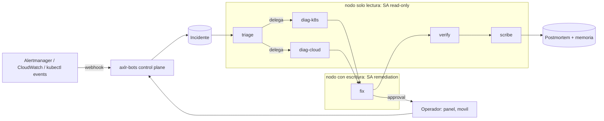
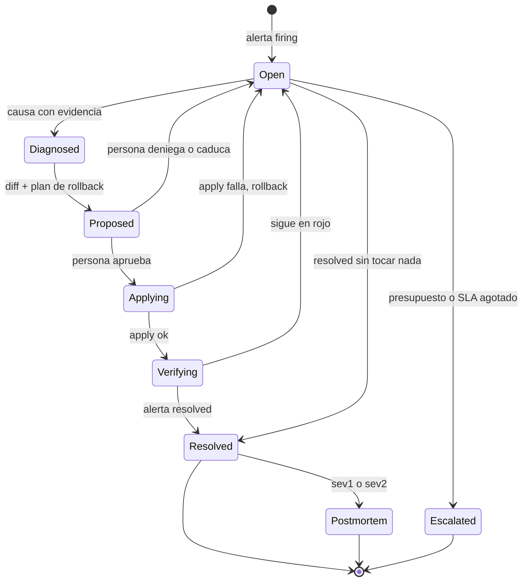
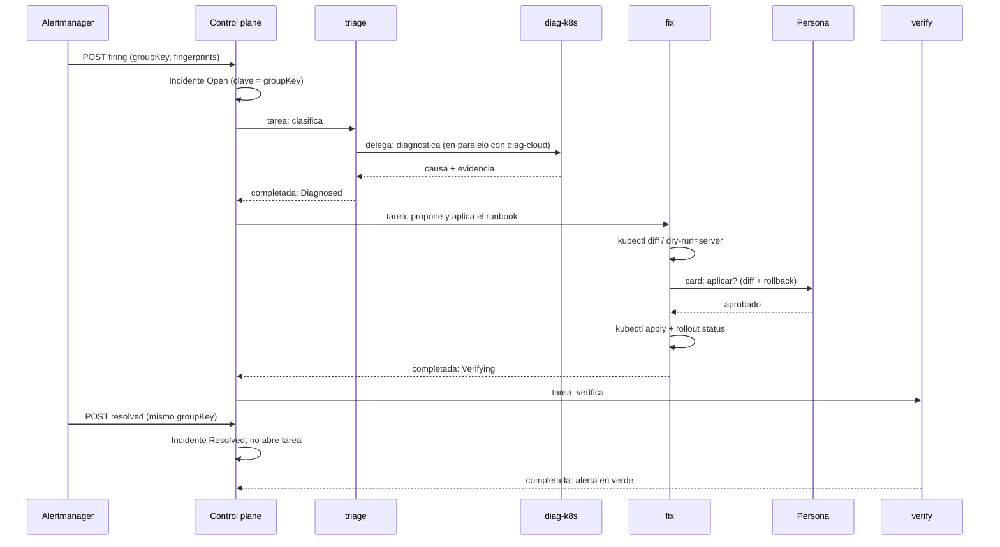

# Diseño: AXLR Bots para resolver incidencias en Kubernetes y cloud

**Estado:** diseño, revisión 2.1, 31 de octubre de 2026. Las diez decisiones de §13 están tomadas. Nada está implementado salvo lo marcado como «ya existe»; la fase 0 está detallada en §12.1.
**Nombre:** *AXLR Bots SRE* (Q1). **Repo:** `axlr-sre`, producto propio sobre [AXLR Bots](https://github.com/underpass-ai/axlr-bots) (Q10). Los enlaces a runbooks, ADRs y ejemplos apuntan al repo axlr-bots.

---

## 1. En una pantalla

Una **brigada** de bots recibe la alerta, diagnostica, propone el arreglo con su diff, lo aplica cuando una persona dice sí, verifica y escribe el postmortem. El modelo propone; la política y la persona deciden; el panel lo enseña todo.

| Bot | Hace | Nivel | Dónde corre |
|---|---|---|---|
| `triage` | clasifica la alerta, abre el incidente, reparte el trabajo | observe | nodo solo lectura |
| `diag-k8s` | `get`, `describe`, `logs`, `events`, `diff`; dice la causa con evidencia | observe | nodo solo lectura |
| `diag-cloud` | `describe` de AWS: EKS, EC2, RDS, ELB, CloudWatch | observe | nodo solo lectura |
| `fix` | runbook: diff, dry-run, plan de rollback, apply | act-with-approval | nodo con escritura |
| `verify` | `rollout status`, alerta en verde, cierra | observe | nodo solo lectura |
| `scribe` | timeline, postmortem, memoria | propose | nodo solo lectura |

---

## 2. Qué ya existe y qué hay que construir

Esta tabla es la columna vertebral del diseño. Todo lo demás cuelga de ella.

| Pieza | Ya existe | Hay que construir |
|---|---|---|
| Entrada por webhook con HMAC y clave por entrega | sí ([triggers](https://github.com/underpass-ai/axlr-bots/blob/main/docs/runbooks/triggers.md)) | adaptador **Alertmanager**: clave por `groupKey`/`fingerprint`, `resolved` cierra en vez de abrir (§5) |
| Timers | sí | — |
| Equipos, pub/sub (`danger`, `stop`, `warn`, `info`, `error.bot`, `warn.approval`, `done.task`) | sí ([ADR](https://github.com/underpass-ai/axlr-bots/blob/main/docs/architecture/pubsub-events.md)) | topics del incidente (§6) |
| Delegación con presupuesto, profundidad y ciclo | sí ([ADR](https://github.com/underpass-ai/axlr-bots/blob/main/docs/architecture/delegation.md)) | — |
| Tareas urgentes, `stop.all` como interruptor | sí | — |
| Aprobaciones con TTL y `autoApprove` por tool | sí ([runbook](https://github.com/underpass-ai/axlr-bots/blob/main/docs/runbooks/approvals.md)) | **quién** puede aprobar; dos personas en producción (§8) |
| Nodo como sidecar en un pod, mTLS, Helm | sí ([runbook](https://github.com/underpass-ai/axlr-bots/blob/main/docs/runbooks/sidecar.md)) | un nodo por ServiceAccount: lectura y escritura separadas (§7) |
| Panel: aprobar, denegar, avisos de escritorio, móvil | sí | pantalla **Incidentes** (§9) |
| Skills firmadas del catálogo, fijadas por ejecución | sí (AXLR #187) | los **runbooks** como skills (§8) |
| Sandbox por ejecución, router de modelos, presupuesto por ejecución | sí (AXLR #183, #186, #178) | presupuesto **por incidente** y por día (§8) |
| Ceremonia `axlr_incident` (postmortem sin culpa) en MADE | sí | encajarla en `scribe` o no (Q8) |
| Bot de drift en kind, fase 0 probada el 29 Oct | sí ([examples/k8s-drift](https://github.com/underpass-ai/axlr-bots/blob/main/examples/k8s-drift/README.md)) | el laboratorio de escenarios (§11) |
| Agregado **Incidente** | no | sí (§4) |
| Acceso a Kubernetes por verbo, con política limpia | no (hoy `local_exec kubectl` con globs) | sí (§7, Q3) |
| Salidas: Slack, Teams, página de estado | no | adaptador de salida (§10) |
| Autonomía progresiva por runbook | no | sí (§8) |
| Memoria acotada al incidente | no (hoy las notas se cuelan entre tareas) | sí (§10) |

---

## 3. Problema y posicionamiento

**Problema.** Una alerta despierta a una persona. Ella hace a mano siempre lo mismo: `describe`, `logs`, `events`, buscar el cambio, deshacerlo, mirar si vuelve el verde. Los productos de «AIOps» lo automatizan en su nube, con su modelo, sin dejar ver por qué el agente hizo cada cosa.

| AXLR Bots SRE | Lo que ofrece |
|---|---|
| Self-hosted | el control plane y los nodos en tu clúster; el modelo, el que tú elijas (local o remoto) |
| Política fuera del modelo | cada `kubectl` pasa por la política y por RBAC; el LLM nunca concede permisos |
| Persona en el bucle | el diff antes del apply; aprobación desde el panel o el móvil; TTL |
| Auditable | cada incidente: alerta, tareas, llamadas, decisiones, coste, trace |
| Bots como infraestructura | la brigada es un recurso declarado; sobrevive a reinicios; se instala con Helm |
| Progresivo | un runbook gana autonomía con el historial de aprobaciones, no con el prompt |

No se afirma nada sobre productos concretos de la competencia: no está verificado aquí.

---

## 4. El agregado Incidente

Hoy el control plane tiene Bot, Task, Execution, Node y Group. Ninguno representa «un grupo de alertas → N tareas → resuelto». Sin él, el panel no puede enseñar un incidente ni contar su coste. Decisión por defecto: **nuevo agregado** (Q2).

| Campo | Contenido |
|---|---|
| `id` | acuñado por el control plane (`inc-…`); el `groupKey` es un campo. Dos incidentes pueden compartir `groupKey` (uno resuelto hace tiempo y otro nuevo): la búsqueda devuelve el **más reciente** |
| `fingerprints` | las alertas del grupo; una nueva alerta en el mismo grupo se añade, no abre otro |
| `severity` | `sev1`..`sev4`, del label `severity` de la alerta o de `triage` |
| `status` | el diagrama de abajo |
| `tasks` | las tareas que lo tocaron, en orden, con su bot |
| `evidence` | las llamadas de lectura y sus salidas, por referencia a las ejecuciones |
| `proposal` | el diff, el runbook, el plan de rollback, quién lo propuso |
| `approvals` | quién aprobó o denegó cada paso y cuándo |
| `cost` | suma de las ejecuciones; `budget` del incidente |
| `timeline` | derivada de los eventos del bus y de las tareas |
| `postmortem` | referencia al artefacto |

Reglas:

| Regla | Decisión |
|---|---|
| cada fase es **una tarea** propia | el sidecar pierde una aprobación en espera si el pod muere; nada largo cruza una aprobación |
| una tarea no cambia el estado por sí sola | el control plane sabe qué fase lanzó cada tarea: al completarse, hace la transición y lanza la tarea de la fase siguiente. AXLR no cambia |
| la delegación no cruza fases | `triage` delega solo a `diag-k8s` y `diag-cloud` (en paralelo); `fix`, `verify` y `scribe` los arranca el control plane, nunca un bot padre que esperaría durante la aprobación |
| clave | el incidente por `groupKey`; cada alerta dentro por `fingerprint` |
| `Escalated` | presupuesto del incidente agotado, SLA de diagnóstico pasado o `fix` denegado dos veces: aviso a la persona, el incidente queda abierto a mano |
| reapertura | un `firing` sobre un incidente `Resolved` hace menos de 30 min (`IncidentReopenWindow`, constante del dominio en la fase 0) lo reabre con un ciclo más; después abre otro |

---

## 5. Entradas

Las entradas son adaptadores de entrada ([ADR](https://github.com/underpass-ai/axlr-bots/blob/main/docs/architecture/input-adapters.md)): la fuente llega al bot como texto, evento o nota.

| Fuente | Fase | Clave de deduplicación | Qué hace |
|---|---|---|---|
| **Alertmanager** webhook | 1 | `groupKey` + `fingerprint` | `firing` abre o reabre; `resolved` pasa a `Verifying`/`Resolved` y **no abre tarea** |
| **kubectl events** (watcher en el nodo) | 1 | `uid` del Event | `Warning` repetido N veces en M minutos abre incidente de severidad baja |
| **Manual**: panel, CLI | 1 | la clave del operador | «mira qué le pasa a `web` en `shop`» |
| **CloudWatch** vía SNS | 2 | `AlarmName` + `StateChangeTime` | `ALARM` abre; `OK` cierra |
| **Argo CD** sync failed | 3 | `app` + `revision` | abre con el diff de la revisión |
| PagerDuty, Grafana OnCall | 3 | el id del incidente externo | espejo: el estado va y vuelve |

**Alertmanager rompe la deduplicación de hoy.** Reenvía el mismo grupo cada `repeat_interval` con un cuerpo algo distinto, y `resolved` llega por la misma ruta. Con la clave de hoy (hash del cuerpo) cada reenvío abriría una tarea y `resolved` otra. Por eso:

| Caso | Hoy | Diseño |
|---|---|---|
| reenvío del mismo grupo | tarea nueva | mismo incidente; se anota `repeat`, nada más |
| alerta nueva en el grupo | tarea nueva | se añade al incidente; si está `Diagnosed` o más, nota para `verify` |
| `resolved` | tarea nueva | transición de estado; tarea de `verify` solo si el incidente estaba `Applying`/`Verifying` |
| `resolved` por alerta | — | el receiver necesita `send_resolved: true`; el `status` del grupo sigue `firing` mientras una alerta siga en rojo: cada alerta se resuelve sola, el incidente cuando se resuelve el grupo |
| `firing` mientras `Proposed` | tarea nueva | nota en la tarea pendiente (coalescing de hoy) |

---

## 6. La brigada: equipo, topics, delegación

Un equipo `sre` con los seis bots. Lo que ya dan los equipos: se ven entre sí, se delegan sin nombrarse, oyen `danger.*` y `stop.*`.

| Topic | Kind | Quién emite | Quién oye, modo |
|---|---|---|---|
| `info.incident.opened` | info | control plane | `scribe` (note) |
| `warn.incident.diagnosed` | warning | `diag-*` | `triage` (message si trabaja) |
| `warn.approval` | warning | control plane | `triage` (note), operador por aviso de escritorio |
| `danger.incident.sev1` | critical | `triage` | `diag-*` y `verify`: tarea urgente. `fix` lleva `events.interruptible: false`: una tarea en `WaitingApproval` no se interrumpe; el rollback lo lanza el control plane como tarea nueva |
| `stop.all` | critical | operador | interruptor: todo se para |
| `error.bot` | critical | control plane | `triage` (task): reintenta o escala |
| `done.task` | info | control plane | `scribe` (note) |

Delegación solo dentro de una fase: `triage` → `diag-k8s` y `diag-cloud`, `wait: true`, `maxChildren: 2`, `split: even`, `budgetShare` 0.5, profundidad 1. Las fases `fix`, `verify` y `scribe` las arranca el control plane al cambiar el estado del incidente (§4): un padre que esperase una aprobación sería justo lo que §4 prohíbe.

Modelos por el router: `triage` y `verify` con el modelo barato (`cost-optimized`); `diag-*` y `fix` con el fuerte (`quality-first`); `scribe` barato. Fallback una vez.

---

## 7. Acceso a Kubernetes y a la nube

Dos capas siempre: la política de AXLR decide la llamada; RBAC e IAM deciden lo que el proceso puede hacer aunque la política falle.

### 7.1 Cómo llama el bot a kubectl (Q3)

| Opción | A favor | En contra |
|---|---|---|
| (a) `local_exec kubectl` + tool rules | existe hoy; el drift bot corrió así | los globs paran en `/`; `diff` exit 1 sale como `failed`; `delete` solo se bloqueó al nombrarlo exacto |
| (b) **servidor MCP `kube` con una tool por verbo** (`kube_get`, `kube_describe`, `kube_logs`, `kube_events`, `kube_diff`, `kube_apply`, `kube_rollout`, `kube_scale`) | la política es por tool, sin globs; cada tool valida sus argumentos (namespace, bounds); `diff` devuelve «hay diferencias», no error | hay que escribirlo (Go, pequeño, en el nodo como el relé de delegación) |
| (c) tools del catálogo firmado | versionadas, fijadas por ejecución | el catálogo no ejecuta nada por sí mismo; (b) y (c) se combinan: (c) distribuye (b) |

Por defecto **(b)**, publicada como entrada del catálogo (c). Cada tool recibe el `namespace` como argumento y lo contrasta con `allowedNamespaces` de la definición del bot.

### 7.2 Un nodo por ServiceAccount

Las ejecuciones comparten el sidecar: su usuario, su ServiceAccount, sus límites ([sidecar](https://github.com/underpass-ai/axlr-bots/blob/main/docs/runbooks/sidecar.md#trade-offs)). Un bot de lectura y uno de escritura en el mismo pod tendrían los mismos permisos de RBAC. Por eso:

| Nodo | ServiceAccount | Bots | RBAC |
|---|---|---|---|
| `sre-ro` | `axlr-sre-read` | `triage`, `diag-k8s`, `diag-cloud`, `verify`, `scribe` | `get`, `list`, `watch` en todo menos `secrets`; `pods/log`. Ningún acceso a Secret: RBAC no sabe dar «solo nombres»; el runbook `missing-config` lee el nombre en los eventos del pod |
| `sre-rw` | `axlr-sre-write` | `fix` | lo de arriba más `patch`, `update` en Deployment, StatefulSet, HPA, ConfigMap; `delete` solo de Pod; **nunca** Namespace, PVC, CRD, Node, Secret |

Placement por `labels`: `{"role": "sre-ro"}` y `{"role": "sre-rw"}`. Un Job por ejecución (identidad por ejecución) queda fuera, como hoy.

### 7.3 Cloud: AWS primero, estrecho (Q5)

| Rol IAM | Para | Permisos |
|---|---|---|
| `axlr-sre-read` (IRSA en `sre-ro`) | `diag-cloud` | `Describe*`, `Get*`, `List*` en EKS, EC2, RDS, ELBv2, CloudWatch, Logs |
| `axlr-sre-remediate` (IRSA en `sre-rw`) | `fix` | acotado con *permission boundary*: `ec2:RebootInstances`, `rds:RebootDBInstance`, `autoscaling:SetDesiredCapacity` dentro de bounds, `eks:UpdateNodegroupConfig` |

Ninguna credencial compartida; nada de claves en el entorno del nodo salvo la del modelo. GCP y Azure después, con el mismo molde.

---

## 8. Seguridad, runbooks y autonomía

### 8.1 Radio de explosión: una lista, no adjetivos

| Nunca | Siempre antes de un apply | Límites |
|---|---|---|
| borrar Namespace, PVC, CRD, Node, Secret | `kube_diff` y `dry-run=server` | escalar solo dentro de `scale.min..max` del runbook |
| `drain` de nodos | plan de rollback grabado en el incidente | un apply por tarea |
| tocar namespaces fuera de `allowedNamespaces` | la persona ve el diff entero | `maxToolCallsPerTask` 20, `taskTimeoutSeconds` 600 |
| cambiar RBAC, NetworkPolicy, webhooks de admisión | — | ventanas de cambio: en prod, fuera de ventana solo rollback |
| escribir en prod con una sola decisión (sev1/sev2) | — | `stop.all` para todo, siempre |

Quién puede aprobar no existe hoy (está en «left out»). Hay que construir: `approvers` por bot y por namespace, y `twoPersons: true` para los namespaces de producción. Hasta entonces, producción solo en `propose`.

### 8.2 Runbooks como skills firmadas

Un runbook es una skill del catálogo, versionada y fijada por ejecución (AXLR #187). Cada una dice: cuándo aplica, qué lee, qué diff produce, qué bounds tiene, cómo se verifica, cómo se deshace.

| Runbook | Síntoma | Lee | Arreglo | Verifica |
|---|---|---|---|---|
| `crashloop` | `CrashLoopBackOff` | logs previos, probes, env | rollback a la revisión anterior | rollout + alerta verde |
| `oom` | `OOMKilled` | límites, uso real | subir `limits.memory` ≤ 2× dentro de bounds | sin reinicios 10 min |
| `image-pull` | `ImagePullBackOff` | tag, secret del registry | tag anterior o aviso (secret caducado: solo propone) | pods Running |
| `missing-config` | `CreateContainerConfigError` | ConfigMap/Secret por nombre | propone; no crea secrets | — |
| `pvc-full` | disco al 95 % | uso, StorageClass | ampliar PVC si la clase lo permite | uso < 80 % |
| `node-notready` | `NotReady` | kubelet, presión, cloud | cordon + aviso; reboot de la instancia con aprobación | `Ready` |
| `hpa-maxed` | HPA en `maxReplicas` | métricas, límites del nodo | subir `maxReplicas` dentro de bounds | CPU bajo objetivo |
| `drift` | diff ≠ 0 | manifiestos deseados | `apply` del deseado (el bot del 29 Oct) | diff limpio |
| `cert-expiry` | cert < 7 días | Certificate, Issuer | renovación forzada | nuevo `notAfter` |
| `rollback-last` | cualquier sev1 tras un deploy | historial de rollout | `rollout undo` | alerta verde |

### 8.3 Autonomía progresiva por runbook

Hoy `autoApprove` es por tool. Aquí la unidad es el runbook en un namespace:

| Escalón | Qué hace el bot | Cómo sube |
|---|---|---|
| observe | lee y dice la causa | de serie |
| propose | diff y plan de rollback | tras 5 diagnósticos que una persona marcó como correctos en el panel |
| act-with-approval | aplica cuando una persona dice sí | tras 10 propuestas aprobadas sin editar |
| act-within-policy | aplica solo dentro de los bounds del runbook | tras 20 aplicaciones aprobadas y verificadas en verde; **nunca en prod sev1** |

Las señales son siempre actos de una persona: aprobar sin editar, denegar, marcar un diagnóstico, un apply verificado. Jev no promociona nada en producción (no hay respuesta esperada); juzga solo en el laboratorio (§11). Una denegación baja un escalón; un rollback fallido baja dos. El panel enseña el escalón y el historial.

### 8.4 Presupuesto

| Nivel | Límite | Qué pasa al agotarse |
|---|---|---|
| ejecución | el de hoy (`--budget`) | la tarea falla con `budget_exceeded` |
| **incidente** | `maxCostPerIncident` (p. ej. 2 $) y `maxTasksPerIncident` (12) | `Escalated` |
| día, por tenant | `maxCostPerDay` | solo `observe` hasta mañana; aviso |

---

## 9. El panel: pantalla Incidentes

Principio de la casa: desde el panel el operador siente que controla sus bots.

| Vista | Enseña | Acciones |
|---|---|---|
| **Incidentes** (lista) | abiertos por severidad, estado, desde cuándo, qué bot trabaja, coste; «necesitan de ti» arriba | abrir, escalar a persona, cerrar a mano |
| **Incidente** | alerta original, causa con evidencia (cada `kubectl` y su salida), el diff, el plan de rollback, timeline, coste, trace | **Aprobar**, **Denegar**, **Rollback**, **Parar brigada**, pedir otro diagnóstico |
| **Runbooks** | cada runbook: versión, escalón por namespace, historial de aprobaciones | subir o bajar escalón a mano |
| **Brigada** (equipo `sre`) | los seis bots, en qué están, topics, quién oye qué | `stop.all` |
| **Móvil** | la card de aprobación con el diff resumido (ya existe en la flota) | Aprobar, Denegar |
| **Home** | cuenta de incidentes abiertos y MTTR del día junto a lo de hoy | — |

---

## 10. Salidas y memoria

**Salidas** (no existen; adaptador de salida, espejo del de entrada):

| Salida | Fase | Qué manda |
|---|---|---|
| Slack / Teams | 2 | incidente abierto, causa, card con enlace al panel, resuelto |
| página de estado | 3 | solo sev1/sev2 resueltos |
| PagerDuty | 3 | acknowledge y resolve |

**Memoria**, en dos capas:

| Capa | Dónde | Regla |
|---|---|---|
| del incidente | notas del equipo, acotadas por `incidentId` | caducan al cerrar el incidente; nunca se cuelan en otro (hoy sí: «una llamada fue rechazada una vez») |
| de la flota | KMP, con procedencia | «incidente parecido el 12 Oct, arreglo X, verificado»; `diag-*` la consulta antes de leer el clúster; fase 3 |

**Postmortem** (`scribe`): timeline desde los eventos, causa, acciones con dueño y fecha, en Markdown en el repo del clúster. Con MADE, la ceremonia `axlr_incident` ya hace triage, timeline, análisis, revisor fresco y aprobación humana (Q8).

---

## 11. Laboratorio y medidas

Como el drift bot: todo se prueba en kind, con la brigada real, y cada fase sale con un número.

| Escenario | Inyección | Diagnóstico esperado |
|---|---|---|
| crashloop | imagen que sale con 1 | «el proceso sale con código 1: ver log; rollback» |
| oom | `limits.memory: 32Mi` en nginx | «OOMKilled: límite 32Mi, uso 60Mi» |
| image-pull | tag inexistente | «tag `1.99` no existe en el registry» |
| missing-secret | env de un Secret borrado | «Secret `db` no existe en `shop`» |
| pvc-full | `dd` hasta llenar | «PVC al 100 %» |
| node-notready | parar kubelet del worker | «kubelet parado en `worker-2`» |
| netpol | NetworkPolicy que corta el DNS | «NetworkPolicy `deny-all` bloquea 53/UDP» |
| hpa-maxed | carga con `hey` | «HPA en `maxReplicas` 3» |
| cert-expiry | cert con `duration: 1h` | «caduca en 20 min» |
| drift | lo del 29 Oct | lo del 29 Oct |

Alertmanager real en el kind (kube-prometheus-stack) mandando a `POST /v1/triggers/triage/alertmanager`, con `repeat_interval: 2m` para provocar los reenvíos.

| Medida | Cómo | Objetivo fase 1 | fase 3 |
|---|---|---|---|
| causa correcta | Jev juzga contra el diagnóstico esperado | 8/10 | 10/10 |
| tiempo hasta diagnóstico | `Open` → `Diagnosed` | < 3 min | < 90 s |
| aprobaciones por incidente | del agregado | ≤ 1 | ≤ 1 |
| coste por incidente | del agregado | < 0,10 $ | < 0,05 $ |
| incidentes duplicados por reenvío | del agregado | 0 | 0 |
| falsos apply | `Applying` sin `Proposed` aprobado | 0 | 0 |

---

## 12. Fases

| Fase | Entra | Sale cuando |
|---|---|---|
| **0** laboratorio | kind + 10 escenarios + Alertmanager; brigada en `observe`; adaptador Alertmanager con `groupKey`; agregado Incidente mínimo (`Open`/`Resolved`) | 0 duplicados en 1 h de reenvíos; 8/10 causas |
| **1** proponer | tool `kube` por verbo; nodos `sre-ro`/`sre-rw`; pantalla Incidentes; `fix` en `propose` | el diff de cada escenario es el esperado; el panel enseña el incidente entero |
| **2** actuar con aprobación | runbooks como skills firmadas; `fix` en `act-with-approval`; Slack; `diag-cloud` con rol de lectura en AWS | 10/10 escenarios arreglados con una aprobación; móvil probado |
| **3** actuar solo | autonomía progresiva por runbook; quién aprueba y dos personas en prod; postmortem; KMP; CloudWatch; rol de remediación en AWS | un runbook llega a `act-within-policy` solo por historial; un postmortem aprobado por una persona |

### 12.1 Fase 0 en detalle

Objetivo: que una alerta real de Alertmanager en kind abra **un** incidente, que `triage` y `diag-k8s` digan la causa, y que los reenvíos y el `resolved` no abran nada. Solo lectura, solo Kubernetes, un nodo, sin panel. Cuatro PRs: los dos del control plane en **axlr-bots**, los dos del producto en **axlr-sre**.

| PR | Repo | Qué entra | Dónde | Sale cuando |
|---|---|---|---|---|
| **0** este diseño | axlr-sre | rev 2, README del repo | `docs/design.md` | primer commit |
| **1** agregado Incidente, **abierto como [axlr-bots#78](https://github.com/underpass-ai/axlr-bots/pull/78)** | axlr-bots | `Incident` con `id`, `groupKey`, `fingerprints` (los 64 primeros), `severity`, `status` (`Open`, `Diagnosed`, `Resolved`, `Escalated`), `cycle`, `tasks`, `cost`; store de un JSON por incidente; `GET /v1/incidents`, `GET /v1/incidents/{id}`, `POST /v1/incidents` (manual), `POST /v1/incidents/{id}/resolve`; eventos `incident.opened`, `incident.repeated`, `incident.reopened`, `incident.diagnosed`, `incident.escalated`, `incident.resolved`; CLI `incident open`, `incident list`, `incident get`, `incident resolve`; trigger `incident` que el bot declara; la tarea de `triage` lleva `incidentId` y, acabe donde acabe, mueve el incidente: completada → `Diagnosed`, cualquier otro fin → `Escalated` | `domain/incident.go`, `application/open_incident.go`, `application/incident_advancer.go`, `adapters/filestore/`, `adapters/unixapi/`, `cmd/axlr-bots/` | tests: abrir dos veces el mismo `groupKey` es un incidente; reabrir dentro de `reopenWindow` enlaza, fuera abre otro; una tarea completada cambia el estado una sola vez |
| **2** trigger `alertmanager`, **abierto como [axlr-bots#80](https://github.com/underpass-ai/axlr-bots/pull/80)** (sobre #78) | axlr-bots | un tipo de trigger nuevo sobre el webhook de hoy: mismo `secret`/`signingKey`, cuerpo del webhook v4 de Alertmanager; `firing` nuevo → incidente + tarea de `triage` con la alerta como `input`; `firing` repetido → `incident.repeat`, sin tarea; alerta nueva en el grupo → se añade, nota si ya está `Diagnosed`; `resolved` por alerta → se marca; grupo resuelto → `Resolved`, sin tarea; cuerpo que no es de Alertmanager → `400` | `domain/trigger.go`, `application/fire_alertmanager.go`, `adapters/httpapi/triggers.go`, `docs/runbooks/triggers.md` | tests con los tres cuerpos reales (firing, repeat, resolved) grabados del lab; 30 reenvíos = 1 incidente |
| **3** laboratorio, **abierto como [axlr-sre#1](https://github.com/underpass-ai/axlr-sre/pull/1)** | axlr-sre | `lab/up.sh` (kind + kube-prometheus-stack con el receiver al control plane, `repeat_interval: 2m`, `send_resolved: true`); `scenarios/<nombre>/{inject.sh,clear.sh,expected.md}` para los 10 de §11; `bots/triage.json`, `bots/diag-k8s.json` (equipo `sre`, `observe`, `local_exec kubectl` con reglas de solo lectura, delegación `triage` → `diag-k8s`); `README.md` con la corrida | `lab/`, `scenarios/`, `bots/` | los 10 escenarios disparan su alerta y abren un incidente cada uno en el kind de gx10 |
| **4** juez y corrida, **abierto como [axlr-sre#2](https://github.com/underpass-ai/axlr-sre/pull/2)** (sobre #1) | axlr-sre | `judge/run.sh`: por escenario, inyecta, espera `Diagnosed`, pide a Jev (`jev-1.13.0` directo a TypeSafe, el mismo pin que la `judge_policy` `axlr-v2` de AXLR; una pregunta por hecho de `expected.md`) que compare la respuesta con `expected.md`, limpia; imprime la tabla de §11 (causa, tiempo, coste, duplicados); el README guarda la corrida real | `judge/`, `README.md` | **≥ 8/10 causas correctas, 0 duplicados en 1 h de reenvíos**, coste total de la corrida apuntado. Corrida del 1 de noviembre: 10/10 incidentes, 0 duplicados en 15 reenvíos, $0.071; Jev da 6 correctas + 4 parciales con su regla (todos los hechos esperados), 10/10 si «correcta» es nombrar la causa. **Decidido el 1 de noviembre: cuenta la regla estricta de Jev**; la fase 0 no está superada y se mejoran los bots, no la regla. **Superada el mismo 1 de noviembre** tras mejorar los bots (`bots/runbook.md`, `rollout` denegado, el informe es siempre el último mensaje): 10/10 correctas con la regla estricta, 0 duplicados en 15 reenvíos, $0.093 |

Qué corre dónde en la fase 0:

| Pieza | Dónde |
|---|---|
| control plane y nodo | gx10, `systemctl --user`, construidos de `main` como el 29 Oct |
| clúster | kind `sre-lab` en gx10 (el `drift-lab` sirve de base) |
| Alertmanager | dentro del kind; el receiver apunta al puerto de operador del control plane en el host |
| `kubectl` | el del usuario del nodo, como en el drift bot; la tool `kube` por verbo llega en la fase 1 |
| modelo | el router: `triage` barato, `diag-k8s` fuerte; estimación de la corrida completa < 1 $ (el drift bot costó 0,002–0,01 $ por tarea) |

Lo que la fase 0 deja fuera a propósito: `diag-cloud` (fase 2), `fix` y `verify` (fase 1), los dos nodos por ServiceAccount (fase 1), la pantalla Incidentes (fase 1), la tool `kube` (fase 1). `triage` en fase 0 usa `local_exec kubectl` con las reglas del drift bot, aceptando sus límites conocidos (globs con `**`, `diff` exit 1 explicado en la misión).

Riesgos de la fase 0 y qué se mira:

| Riesgo | Señal | Salida |
|---|---|---|
| el `groupKey` cambia si cambian los labels del grupo | dos incidentes para una avería | agrupar en Alertmanager por `alertname, namespace` y nada más |
| `kube-prometheus-stack` tarda en alertar (`for: 5m`) | la corrida de 10 escenarios dura > 1 h | reglas del lab con `for: 1m` |
| Jev juzga con dureza una causa correcta dicha de otra forma | < 8/10 con diagnósticos buenos | `expected.md` lista hechos, no frases; el juez puntúa hechos |
| la nota de un escenario se cuela en el siguiente | menciones a averías ya limpiadas | memoria del bot vaciada entre escenarios en `judge/run.sh`; la memoria por incidente llega en fase 3 |

---

## 13. Decisiones tomadas

Decididas por el usuario el 30 de octubre de 2026: Q1–Q9 con el valor por defecto que proponía la revisión 1; Q10 con la alternativa (repo propio).

| # | Decisión | Decidido | Descartado |
|---|---|---|---|
| Q1 | nombre | *AXLR Bots SRE* | *AXLR Guard*, *la brigada* |
| Q2 | agregado Incidente | sí, nuevo agregado | convención sobre topics + tareas |
| Q3 | acceso a kubectl | servidor MCP `kube` por verbo, distribuido por el catálogo | seguir con `local_exec` + rules |
| Q4 | primeras entradas | Alertmanager + eventos de kubectl + manual | solo Alertmanager |
| Q5 | cloud | AWS, lectura primero; EKS, EC2, RDS, ELB, CloudWatch | GCP primero |
| Q6 | producción por defecto | `propose` hasta que exista «quién aprueba» + dos personas | `act-with-approval` con una persona |
| Q7 | quién aprueba | lista `approvers` por bot y namespace, construida en fase 3 | cualquiera con el token, como hoy |
| Q8 | postmortem | `scribe` solo, Markdown en el repo; MADE `axlr_incident` opcional en fase 3 | MADE desde el principio |
| Q9 | escenarios del laboratorio | los 10 de §11 | quitar `netpol` y `cert-expiry` |
| Q10 | dónde vive | **repo propio `axlr-sre`**: es un producto nuevo. El control plane (agregado Incidente, trigger Alertmanager) sigue en axlr-bots; los bots, los runbooks, la tool `kube`, el lab, el juez y el Helm viven aquí | `examples/sre` dentro de axlr-bots |

---

## 14. Fuera de alcance

Un Job por ejecución; CRDs (`Incident`, `Runbook`) hasta que un servicio normal no baste; multi-clúster con un control plane por clúster federado; GCP y Azure; cambios de infraestructura por Terraform (solo se propone el diff); arreglos de aplicación en el código (eso es otro bot).
